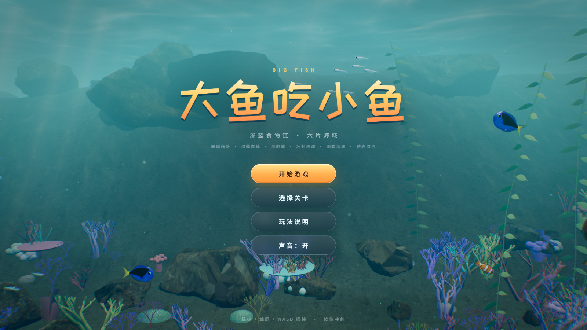

# 大鱼吃小鱼 · BIG FISH

一个用 Three.js 开发的 2.5D 水下吞食成长游戏。吃掉比你小的鱼，躲开比你大的鱼，从珊瑚浅滩一路成长，闯过六片海域。



## 玩法

- 深蓝食物链：吃掉比你小的鱼成长，撞上比你大的鱼会受伤
- 六片海域：珊瑚浅滩 → 海藻森林 → 沉船湾 → 冰封极海 → 幽暗深海 → 熔岩海沟
- 连吃组合、冲刺条、成长阶段、生命值与关卡最高分记录

## 操作

| 操作 | 方式 |
|------|------|
| 移动 | 鼠标 / 触屏 / WASD 方向键 |
| 冲刺 | 按住不放 |
| 暂停 | Esc |

## 快速开始

需要 Node.js 18+。

Windows 直接双击 `启动游戏.bat`；或在项目目录运行：

```bash
npm install
npm run dev
```

浏览器打开 <http://localhost:5173> 即可开始游戏。

## 常用命令

```bash
npm run dev      # 本地开发
npm run build    # 构建到 dist/
npm run preview  # 预览构建产物
npm run assets   # 重新下载 public/assets 素材
npm run shot     # 无头 Chrome 截图（需先启动 dev server）
```

## 技术栈

- [Three.js](https://threejs.org/) 0.180 —— 3D 渲染
- [Vite](https://vitejs.dev/) 7 —— 开发与构建
- 无其他运行时依赖，全部逻辑在本地运行
